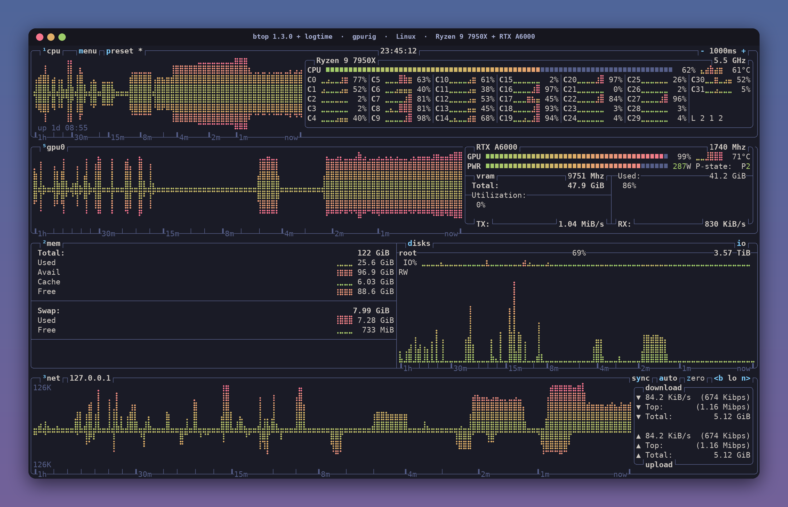
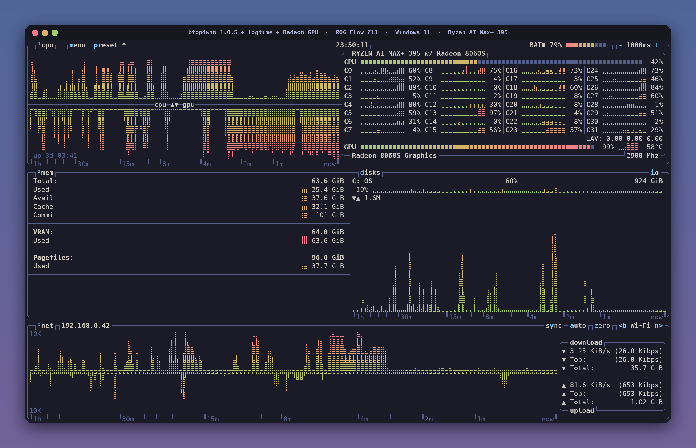

# btop, two ways

Patched builds and configs of [btop](https://github.com/aristocratos/btop) for two machines that look the same, on
two operating systems: an hour of history on a **non-linear time axis** with a labelled ruler, the tokyo-night theme,
and GPU monitoring.

  
   <b><a href="gpurig/README.md">gpurig</a></b> · Linux · btop 1.3.0 + logtime · Ryzen 9 7950X + RTX A6000

  
   <b><a href="z13/README.md">Z13</a></b> · Windows 11 · btop4win 1.0.5 + logtime + Radeon GPU · Ryzen AI Max+ 395

The covers use each machine's real btop layout, labels, colours and time axis. The graphs, meters and per-core
values are synthetic, generated by [`art/make_covers.py`](art/make_covers.py).

## The time axis

Stock btop draws one column per sample, so a graph only reaches back as many seconds as it is wide. These builds
resample each graph's history onto an exponential axis: the newest column is about one second, and every older column
covers more time, out to `graph_history_seconds` (default one hour) at the left edge. The ruler on each box's bottom
border shows where 1m, 2m, 4m, 8m, 15m, 30m and 1h fall.

## What's here

| Path | Contents |
|---|---|
| [`gpurig/`](gpurig/) | Linux build: [README](gpurig/README.md), `logtime.patch`, `gpu-fixes.patch`, `btop.conf` |
| [`z13/`](z13/) | Windows build: [README](z13/README.md), `logtime-win.patch`, `build-cross.sh`, `CPPdll.def`, `btop.conf` |
| [`art/`](art/) | Cover generator and the screen captures it starts from |
| [`assets/`](assets/) | Cover images |

Each machine's README covers the upstream commit, what every patch changes, step-by-step build and install
instructions, the config, known limitations and a changelog.

## License

btop and btop4win are Apache-2.0 (© Aristocratos). The patches here modify that code and are released under the same
[Apache License 2.0](LICENSE), as are the scripts.
