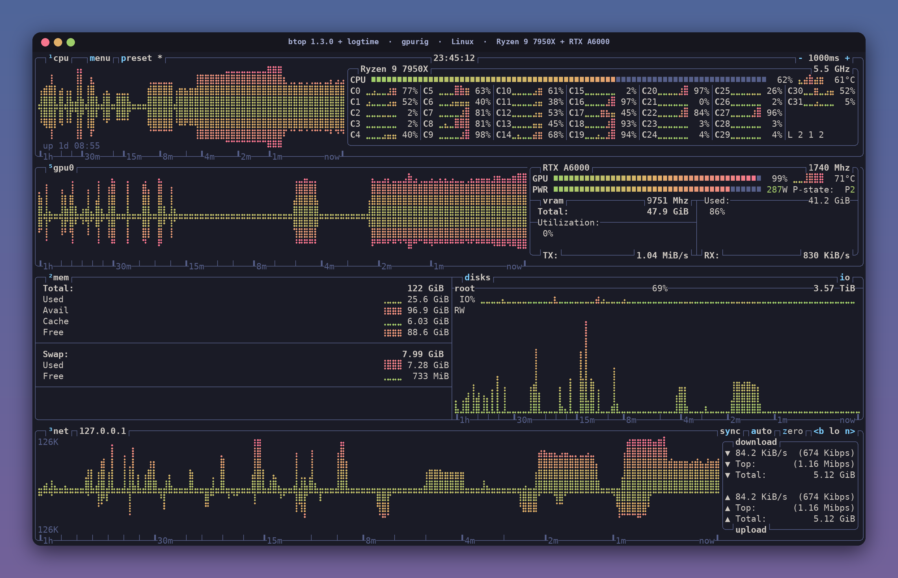

# gpurig — btop 1.3.0 + logtime (Linux)



<sub>Cover: the real btop layout, labels and time axis from this machine, with every graph, meter and per-core value
redrawn from synthetic data (see [`art/`](../art/)). Not a live reading.</sub>

A patched [btop++](https://github.com/aristocratos/btop) 1.3.0 for the Linux workstation **gpurig**
(AMD Ryzen 9 7950X, NVIDIA RTX A6000 48 GB, 128 GB DDR5, Ubuntu). Its main addition is a **non-linear time axis**:
recent history is drawn at full resolution and older history is compressed, so a graph that is ~60 columns wide covers
a full hour, with a labelled ruler (`1h … 30m … 15m … 8m … 4m … 2m … 1m … now`) on the bottom border.

| | |
|---|---|
| Upstream | `aristocratos/btop` at tag `v1.3.0` (commit `36842a3bccfb78f5c27642435bff387b42f7d13b`, 2024-01-07) |
| Patches (apply in order) | [`logtime.patch`](logtime.patch), then [`gpu-fixes.patch`](gpu-fixes.patch) |
| Config | [`btop.conf`](btop.conf) → `~/.config/btop/btop.conf` |
| Theme | `tokyo-night` (ships with btop: `/usr/share/btop/themes/tokyo-night.theme`) |
| Installed binary | `~/.local/bin/btop` (ahead of the distro's `/usr/bin/btop` on `PATH`) |
| Source tree | `~/src/btop-logtime` (upstream clone with both patches applied, uncommitted) |

> **Installed vs. latest build.** As of 2026-11-08 the installed `~/.local/bin/btop` (built 2026-09-26) contains
> **only `logtime.patch`**. A newer build with both patches exists at `~/src/btop-logtime/bin/btop` (2026-10-31) but
> was never copied into place. Run step 4 below to install it.

## What the patches change

### `logtime.patch` — non-linear time axis (+ two small fixes)

- **Log-time graphs.** Each graph keeps its own history (up to `graph_history_seconds`) and is resampled on every
  update onto an exponential time axis. The steepness is solved so the newest column spans about one sample and the
  leftmost column ends exactly `graph_history_seconds` back. Spans are averaged with prefix sums, so redraws are O(width).
- **Time ruler.** Labelled major ticks at round times that roughly double (now, 1m, 2m, 4m, 8m, 15m, 30m, 1h …),
  with unlabelled minor ticks that get denser towards the oldest history. Drawn under the cpu, gpu, net and disk io graphs.
- **Optional fade.** Older columns can blend towards the background (off by default; it asks the terminal for its
  background colour with OSC 11 when `graph_fade_bg = "auto"`).
- **Collectors keep enough history.** Every `while (size > width * 2) pop_front()` in `src/linux/btop_collect.cpp`
  becomes `Config::hist_cap(...)`, so the data behind the graphs reaches back the full hour.
- **Fixes:** `io_graph_speeds` entries are split on `:` (upstream split on whitespace), and the per-disk speed is
  widened to `long long` before the `<< 20` shift.

New config keys (all optional; the defaults below are what this build uses):

| Key | Default | Meaning |
|---|---|---|
| `graph_log_time` | `True` | Non-linear time axis on/off |
| `graph_history_seconds` | `3600` | Age at the left edge, 10–86400 s |
| `graph_time_axis` | `True` | Draw the ruler on the bottom borders |
| `graph_fade` | `False` | Fade older columns |
| `graph_fade_min` | `0` | % of colour the oldest column keeps (0–100) |
| `graph_fade_curve` | `250` | Fade steepness in % (50–500) |
| `graph_fade_bg` | `"auto"` | Fade target: `auto` or `#rrggbb` |

### `gpu-fixes.patch` — GPU handling

- **`gpu_auto_boxes`** (new, default `True`): if `shown_boxes` lists any gpu box, the gpu boxes are rebuilt from the
  GPUs detected this run — one box per GPU when they all fit (max 6), otherwise none, so the cpu box lists every GPU.
  Keeps a saved layout valid when cards are swapped between boots.
- **ROCm SMI ≥ 6:** reads the newer frequency struct layout (`has_deep_sleep` and one more frequency slot); falls
  back to the pre-6 layout when the symbol is missing.
- **NVIDIA:** sizes `gpu_names` from the NVIDIA GPU count (upstream used the already grown `gpus.size()`).
- **Clock reading** goes through the struct layout the loaded ROCm library expects.

## Replicate the build

Tested toolchain: Ubuntu, GCC 15.2 (`g++`), GNU make. GPU support needs the NVIDIA driver (NVML is loaded at runtime)
and/or ROCm SMI for AMD cards; neither is needed at build time.

```bash
# 1. Upstream source at the exact base
git clone https://github.com/aristocratos/btop.git ~/src/btop-logtime
cd ~/src/btop-logtime
git checkout 36842a3bccfb78f5c27642435bff387b42f7d13b     # v1.3.0

# 2. Patches, in order (gpu-fixes.patch prints 3 harmless "space before tab" warnings)
git apply /path/to/this/repo/gpurig/logtime.patch
git apply /path/to/this/repo/gpurig/gpu-fixes.patch

# 3. Build (GPU_SUPPORT defaults to true on Linux x86_64)
make -j"$(nproc)" GPU_SUPPORT=true

# 4. Install for this user only (no sudo), then check
install -m 755 bin/btop ~/.local/bin/btop
btop --version                    # btop version: 1.3.0
strings ~/.local/bin/btop | grep -c graph_log_time    # > 0: logtime patch present
strings ~/.local/bin/btop | grep -c gpu_auto_boxes    # > 0: gpu-fixes patch present

# 5. Config
mkdir -p ~/.config/btop && cp /path/to/this/repo/gpurig/btop.conf ~/.config/btop/btop.conf
```

Verified 2026-11-08: both patches apply cleanly, in order, to a fresh `v1.3.0` export and reproduce
`~/src/btop-logtime/src` exactly. The `make` step was not re-run for this write-up.

## Config highlights

| Setting | Value | Why |
|---|---|---|
| `color_theme` | `"tokyo-night"` | |
| `theme_background` | `False` | Terminal's own background |
| `graph_symbol` | `"braille"` | Two samples per character |
| `shown_boxes` | `"cpu gpu0 mem net"` | No process list |
| `update_ms` | `1000` | One sample per second → 3600 samples per hour of history |
| `rounded_corners` | `True` | |
| `show_coretemp` | `False` | |
| `io_mode` / `io_graph_combined` | `True` / `True` | Disk io as one combined graph |
| `net_sync` | `True` | Upload and download on one scale |
| `gpu_mirror_graph` | `True` | Mirrored gpu graph |
| `disks_filter` | `"exclude=/boot/efi"` | |

## Changelog

Dates before 2026-11-08 come from file timestamps on gpurig; what changed on those days was not recorded.

| Date | Change |
|---|---|
| 2026-09-20 | Previous config saved as `~/.config/btop/btop.conf.bak-2026-09-25` (its last-modified date). |
| 2026-09-25 | Current `btop.conf` written (tokyo-night, braille, `cpu gpu0 mem net`, 1000 ms). |
| 2026-09-26 | `logtime.patch` written; patched btop built and installed to `~/.local/bin/btop`. |
| 2026-10-31 | `gpu-fixes.patch` written and built to `~/src/btop-logtime/bin/btop`; **not installed**. |
| 2026-11-08 | Documented here. Verified both patches reproduce the source tree. No changes to the installed binary or config. |
