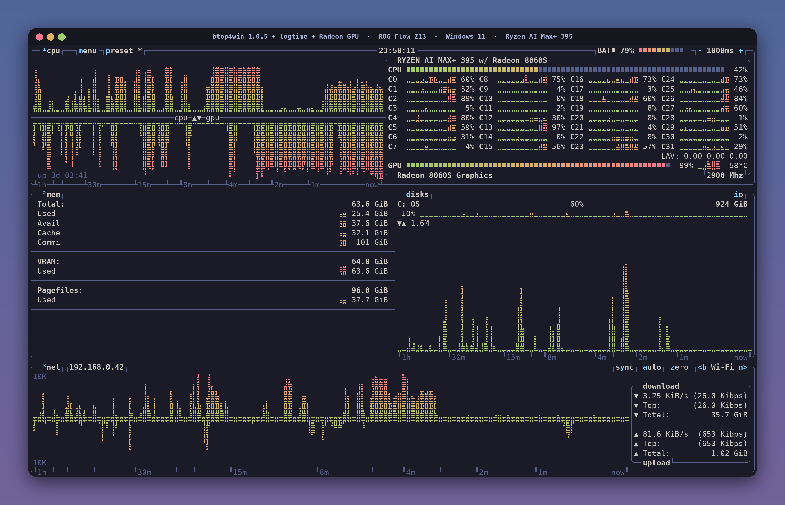

# Z13 — btop4win 1.0.5 + logtime + Radeon GPU (Windows 11)



<sub>Cover: the real btop4win layout, labels and time axis from the tablet, with every graph, meter and per-core value
redrawn from synthetic data (see [`art/`](../art/)). Not a live reading.</sub>

A patched [btop4win](https://github.com/aristocratos/btop4win) (the Windows port of btop, LibreHardwareMonitor
edition) for the **ASUS ROG Flow Z13** (GZ302EA: AMD Ryzen AI Max+ 395, Radeon 8060S iGPU, 128 GB unified memory,
Windows 11 Pro). It is set up to look like the [gpurig build](../gpurig/README.md) and adds:

- the same **non-linear time axis and ruler** (`1h … 30m … 15m … 8m … 4m … 2m … 1m … now`), ported from the Linux patch;
- **working GPU monitoring** on the Radeon 8060S (usage, clock, temperature), which stock btop4win silently disables
  on this machine;
- **VRAM use against the live GPU memory split** (`VRAM: 64.0 GiB` / `Used`), read from the AMD driver every cycle.

| | |
|---|---|
| Upstream | `aristocratos/btop4win` at tag `v1.0.5` (commit `52df9cc`), *Release-LHM x64* configuration |
| Patch | [`logtime-win.patch`](logtime-win.patch) (5 files, +254 / −22) |
| Build | [`build-cross.sh`](build-cross.sh): cross-compiled on Linux with clang-cl + lld-link against Microsoft's CRT/SDK |
| Sensor DLL import library | [`CPPdll.def`](CPPdll.def) (the script turns it into `CPPdll.lib`) |
| Config | [`btop.conf`](btop.conf) → `%USERPROFILE%\scoop\persist\btop-lhm\btop.conf` |
| Install location | `%USERPROFILE%\scoop\apps\btop-lhm\1.0.5\btop.exe` (scoop package `btop-lhm`); original kept as `btop.exe.orig-1.0.5` |
| Run remotely | `ssh -t <z13-host> btop` (the `-t` is required; SSH sessions on the Z13 run elevated, which LHM needs) |

## What the patch changes

### Time axis (port of gpurig's `logtime.patch`)

- `Draw::Graph` gains a log-time mode: each graph keeps its own history and is resampled every update onto the same
  exponential time axis as the Linux build (`TimeAxis`, `_init`, `_rebuild`).
- `Draw::time_axis()` draws the ruler on the bottom border under the **cpu** graph (whose lower half shows the GPU),
  the **disk io** graph and the **net** graph. The ruler is skipped when `cpu_bottom` puts the buttons on that border.
- All 16 history trims in `btop_collect.cpp` use `Config::hist_cap(...)`, so the data reaches back the full hour.
- New config keys, with the same defaults as Linux: `graph_log_time = True`, `graph_history_seconds = 3600`,
  `graph_time_axis = True`.
- **Not ported:** the fade (`graph_fade*`) and its OSC 11 terminal query. The gpurig config has fade off.

### Sensors: GPU, temperatures, VRAM (Windows only)

Root cause: btop4win parses LibreHardwareMonitor's sensor dump and calls `std::stoi` on every value. On this tablet
LHM reports `NaN` for every per-core clock (its WinRing0 driver is blocked, see *Limitations*), the first `stoi("NaN")`
throws, and btop4win then turns off **all** LHM sensors, GPU included. Stock btop4win logs this as
`ERROR: Error during Libre Hardware Monitor parsing: invalid stoi argument`.

- **Unreadable values are skipped, not fatal.** A sensor line whose value isn't a finite number is ignored instead of
  disabling every sensor.
- **0 °C means "not read".** Temperatures ≤ 0 are skipped (`Core (Tctl/Tdie)` reads 0 without the driver), so no fake 0 °C.
- **CRLF stripped.** The dump uses Windows line endings; the trailing `\r` no longer ends up in the GPU clock text.
- **GPU temperature fallback.** The Radeon 8060S has no `GPU Core` temperature sensor in LHM, so `GPU VR SoC`
  is used when no core reading exists. A core reading, if one appears, replaces it.
- **VRAM total follows the BIOS/Armoury Crate split.** The total is read every cycle from the AMD driver's
  `GPU Memory Total` (exactly the configured carve-out, e.g. 65,536 MB = 64 GiB). Windows' slightly smaller
  `D3D Dedicated Memory Total` is used only if the driver figure is missing. `gpu_mem_override = 0` keeps it unpinned.
  Change the split, reboot, and btop shows the new size; no config edit is needed.
- **Label.** The memory box section reads `VRAM:` (`GPU Shared:` on GPUs without dedicated memory) instead of `GPU:`.

Sensor lines btop uses on this tablet (from LHM's dump):

```text
Hardware            AMD Radeon(TM) 8060S Graphics   GpuAmd
GPU Core            Load          1         → GPU usage %, cpu-box lower graph
GPU Core            Clock         696       → MHz
GPU VR SoC          Temperature   45        → GPU temperature (fallback)
GPU Memory Total    SmallData     65536     → VRAM total (MB)
GPU Memory Used     SmallData     65138     → VRAM used (MB)
Core #1             Clock         NaN       → skipped (was fatal)
Core (Tctl/Tdie)    Temperature   0         → skipped
```

`GPU Core | Load` tracks LLM inference: during a 500-token request to a model served on the iGPU, the GPU graph went to
full height and fell back afterwards.

## Replicate the build

Everything runs on a Linux machine; only the finished `btop.exe` goes to the tablet.

**1. Tools** (tested: Ubuntu, LLVM/clang 21):

```bash
sudo apt install clang lld llvm        # provides clang-cl, lld-link, llvm-rc-21, llvm-lib-21
```

**2. Microsoft CRT, ATL and Windows SDK** with [xwin](https://github.com/Jake-Shadle/xwin) 0.10.0 (this accepts
Microsoft's license for the Visual Studio build tools and Windows SDK; about 630 MB unpacked plus a 1.1 GB download cache):

```bash
mkdir -p ~/src/xwin-tool && cd ~/src/xwin-tool
gh release download 0.10.0 -R Jake-Shadle/xwin -p 'xwin-0.10.0-x86_64-unknown-linux-musl.tar.gz*'
sha256sum -c <(sed 's/$/  xwin-0.10.0-x86_64-unknown-linux-musl.tar.gz/' xwin-0.10.0-x86_64-unknown-linux-musl.tar.gz.sha256)
tar -xzf xwin-0.10.0-x86_64-unknown-linux-musl.tar.gz
./xwin-0.10.0-x86_64-unknown-linux-musl/xwin --accept-license --arch x86_64 --include-atl \
    --cache-dir ~/src/xwin-tool/cache splat --output ~/src/xwin-sdk
```

**3. Source, patch and build:**

```bash
git clone https://github.com/aristocratos/btop4win.git ~/src/btop4win-logtime
cd ~/src/btop4win-logtime && git checkout v1.0.5
git apply /path/to/this/repo/z13/logtime-win.patch
mkdir -p external && cp /path/to/this/repo/z13/CPPdll.def external/
cp /path/to/this/repo/z13/build-cross.sh . && ./build-cross.sh      # → build/btop.exe (about 2.7 MB)
```

`build-cross.sh` mirrors the Visual Studio project's *Release-LHM|x64* settings: `/std:c++latest /MT /O2`,
`LHM_Enabled`, `UNICODE`, console subsystem, and a `requireAdministrator` manifest. It also handles the Linux-specific
details:
- case-matching links for `Wbemidl.h` and the `#pragma comment(lib, …)` names, because the SDK is case-sensitive on Linux;
- generating `CPPdll.lib` from `CPPdll.def`, because the import library for the LHM DLL isn't in the btop4win repo;
- forward slashes in the `.rc` icon path.

The build embeds a timestamp, so two builds of the same source have different hashes.

**4. Install on the tablet** (scoop package `btop-lhm` 1.0.5 provides the LHM DLLs; this replaces only `btop.exe`):

```powershell
scoop install btop-lhm        # if not installed yet
$d = "$env:USERPROFILE\scoop\apps\btop-lhm\1.0.5"
Rename-Item "$d\btop.exe" btop.exe.orig-1.0.5     # renaming works even while btop is running
Copy-Item .\btop.exe "$d\btop.exe"
Copy-Item .\btop.conf "$env:USERPROFILE\scoop\persist\btop-lhm\btop.conf"
```

Restart any open btop so it loads the new binary and config. To revert, delete `btop.exe` and rename
`btop.exe.orig-1.0.5` back. A `scoop update btop-lhm` would also replace the patched file (1.0.5 has been the
latest release since 2022).

Verified 2026-11-08: `logtime-win.patch` applies cleanly to a fresh `v1.0.5` export and reproduces the source tree,
and `build-cross.sh` builds from an empty `build/` directory.

## Config highlights

Matched to the gpurig config where btop4win has the same setting:

| Setting | Value | Note |
|---|---|---|
| `color_theme` | `"tokyo-night"` | Theme file copied from gpurig's btop 1.3.0 (the scoop copy was an older version) |
| `theme_background` | `False` | |
| `graph_symbol` | `"braille"` | |
| `rounded_corners` | `True` | |
| `shown_boxes` | `"cpu mem net"` | btop4win has no gpu box. The GPU shows in the cpu box and VRAM in the mem box |
| `cpu_graph_lower` | `"gpu"` | Lower half of the cpu graph is GPU usage |
| `update_ms` | `1000` | |
| `show_coretemp` | `False` | |
| `io_mode` / `io_graph_combined` | `True` / `True` | |
| `net_sync` | `True` | |
| `show_gpu` / `gpu_mem_override` | `True` / `0` | VRAM total comes from the driver |

## Limitations

- **No CPU temperatures or per-core clocks.** LHM needs its WinRing0 kernel driver for those, and Microsoft Defender
  blocks it as `VulnerableDriver:WinNT/Winring0` (correctly: the driver is exploitable). The stock build has the same
  limitation. The block was left in place on purpose.
- **GPU temperature is the SoC voltage-regulator sensor**, not the GPU die. Treat it as a rough indicator.
- **Defender and unsigned builds.** A small unsigned test program built the same way was quarantined as
  `Trojan:Win32/Bearfoos.A!ml` (a machine-learning guess). `btop.exe` itself has not been flagged. No exclusions were added.
- **History starts empty** each time btop starts, as on Linux.
- **Not tested:** changing the VRAM split. The code reads the total every cycle, but a different split has not been tried.

## Changelog

All on 2026-11-08, US Central time. The first two times come from the backup files' creation times; the rest are
from build and install logs and are accurate to about a minute.

| Time | Change |
|---|---|
| 23:17 | Config matched to gpurig: tokyo-night, transparent background, rounded corners, braille, `cpu mem net`, 1000 ms, no core temps, combined io graphs, net sync. Backup: `btop.conf.bak-20261108`. |
| 23:17 | `tokyo-night.theme` replaced with gpurig's copy (the files differed). Backup: `themes\tokyo-night.theme.bak-20261108`. |
| ~23:29 | Time axis ported to btop4win 1.0.5 and cross-compiled. Tested from a separate folder, then installed over the scoop `btop.exe`; original kept as `btop.exe.orig-1.0.5`. |
| ~23:37 | Sensor parsing fixed: `NaN` values skipped instead of disabling all sensors, 0 °C ignored, CRLF stripped. GPU temperature falls back to `GPU VR SoC`. The Radeon 8060S GPU now shows (usage, clock, temperature, lower cpu graph). |
| ~23:50 | VRAM total prefers the AMD driver's `GPU Memory Total` (64.0 GiB, the configured split) over D3D's figure; memory box label `GPU:` → `VRAM:`. |
| ~23:50 | Documented here. `build-cross.sh` made self-contained (shims and `CPPdll.lib` generated). |
